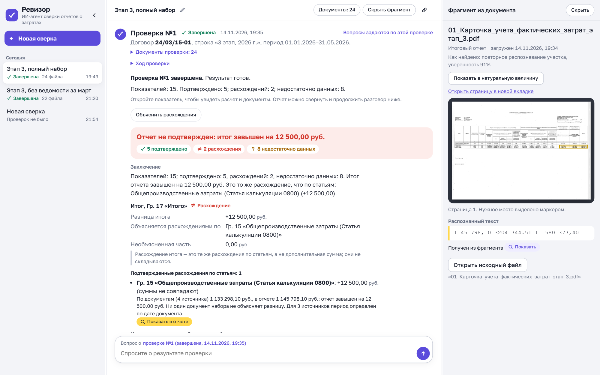
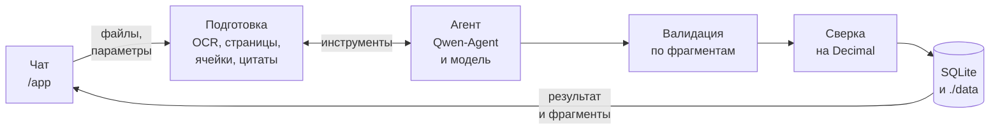
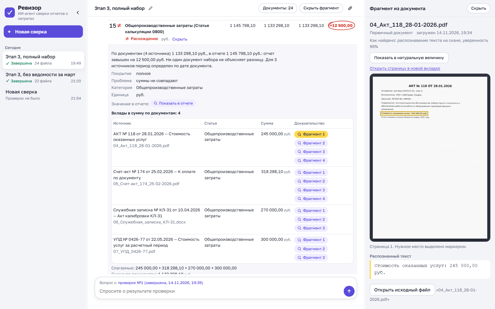
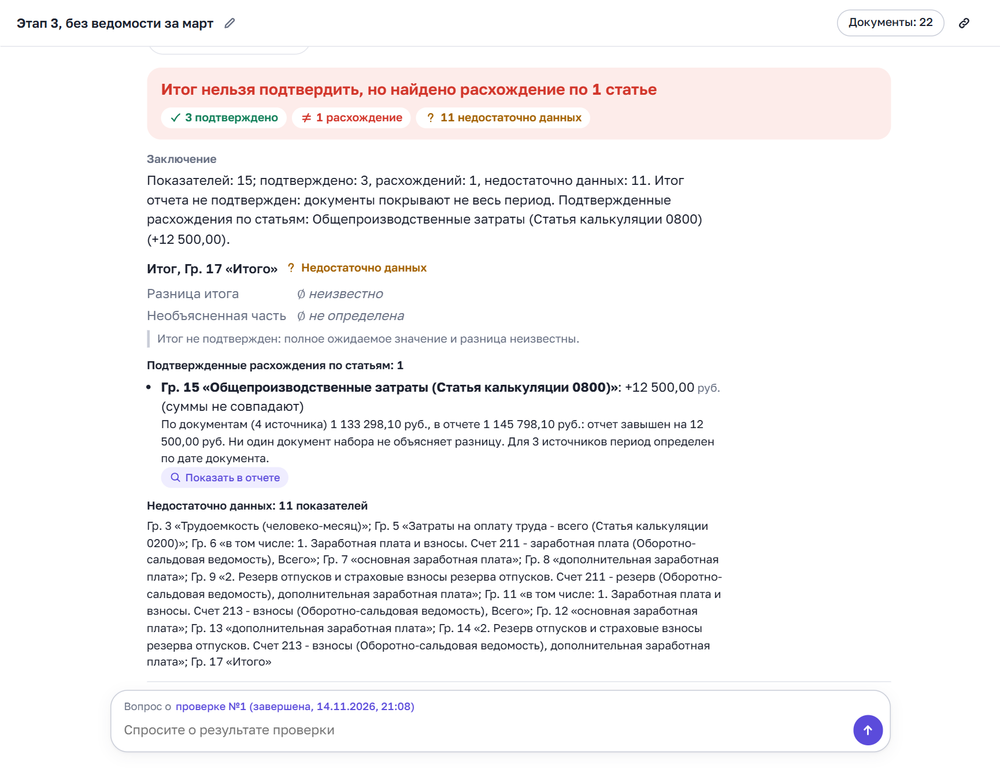

<div align="center">

# Ревизор

**Сверка отчета о фактических затратах (КФЗ) с первичными документами**

ИИ-агент читает отчет и каждый первичный документ, код сверяет суммы,<br>
а результат с подтверждающими фрагментами появляется прямо в чате.


[Быстрый старт](#быстрый-старт) | [Как устроено](#как-устроено) | [Два сценария](#два-сценария) | [Настройки](#настройки) | [Ограничения](#ограничения)

</div>



## Что получает пользователь

- **Статус каждого показателя** строки отчета: подтверждено, расхождение или недостаточно данных; значение в отчете, по документам, разница и категория проблемы.
- **Источник каждой цифры**: документ и фрагмент, то есть область скана с маркером, ячейка XLSX с формулой или цитата DOCX. Исходный файл открывается из чата.
- **Ошибка отличается от нехватки данных.** Если документов не хватает, сумма помечается частичной, а ожидаемое значение и разница остаются неизвестными, а не нулевыми.
- **Исключенные документы с причиной**: дубликат, другой период, другой договор.
- **Вопросы в чате** по сохраненному результату ([пример](docs/assets/readme/follow-up.png)). Ответ опирается на результат проверки и ссылается на те же фрагменты.


## Быстрый старт

Нужны Docker 24+ с Compose v2 и ключ модели с OpenAI-совместимым API, которая поддерживает вызов инструментов и изображения. В образце настроек это DeepSeek `deepseek-flash`. GPU не нужен.

```bash
cp .env.example .env            # вписать ключ в SVERKA_PROVIDER_API_KEY
docker compose up -d --build    # открыть http://localhost:8000/app
docker compose down             # остановка; документы и результаты остаются в ./data
```

В чате нажмите **Новая сверка**, загрузите отчет, первичные документы (можно zip-архивом) и, по желанию, описание набора. Затем укажите договор, строку отчета и период, подтвердите их и нажмите **Запустить проверку**. Строка отчета — подпись проверяемой строки в таблице КФЗ; одна проверка охватывает одну строку.

Пошаговое описание интерфейса: [гид по использованию](docs/user-guide.md). Презентация проекта: [docs/presentation.pdf](docs/presentation.pdf).

Демонстрационный набор лежит в [`examples/case19`](examples/case19): договор `24/03/15-01`, строка `3 этап, 2026 г.`, период 01.01.2026–31.05.2026. Проверка этого набора занимает от 6 до 8,5 минут.

<details>
<summary>Запуск без браузера</summary>

```bash
docker compose run --rm sverka check /app/examples/case19 --out /out/case19 \
    --contract 24/03/15-01 --row "3 этап, 2026 г." --period-from 01.01.2026 --period-to 31.05.2026
```

Результат сохраняется в `out/case19/run.json`. Код возврата: 0, если все показатели подтверждены; 1, если есть расхождения или нехватка данных; 2, если проверка не выполнена.

</details>

## Как устроено



Модель только читает документы и предлагает значения со ссылками на фрагменты. Значение принимается, если процитированный фрагмент того же документа действительно его показывает. Суммы, периоды, дубли и заключение считает обычный код на `Decimal`. К модели обращается только сервер; ключ в браузер не попадает.

| Компонент | Назначение |
|---|---|
| `sverka/static/` | Чат, загрузка файлов, ход проверки, панель фрагментов; без сборки фронтенда |
| `sverka/api.py`, `storage.py` | HTTP API; версии документов, проверки и сообщения в SQLite |
| `sverka/run_service.py` | Полная проверка: подготовка, агент, валидация, сверка, сохранение |
| `sverka/preparation.py`, `document_tools.py` | Подготовка PDF, сканов, XLSX и DOCX; инструменты агента |
| `sverka/harness.py`, `skills/extraction.md` | Цикл агента и его лимиты, ответы в чате; инструкции для модели |
| `sverka/extraction.py` | Проверка предложенных моделью значений по фрагментам |
| `sverka/reconciliation.py` | Ожидаемые значения, статусы, категории и заключение |

Подробнее: [архитектура и контракты](docs/architecture/README.md), [подключение модели и лимиты](docs/harness.md).

## Два сценария

Оба сценария запускались через чат с настоящей моделью 14.11.2026 на наборе `examples/case19`.

**1. Полный набор: отчет, 22 первичных документа и описание набора.** Подтверждено 5 показателей, расхождений 2, недостаточно данных 8. Общепроизводственные затраты (гр. 15): в отчете 1 145 798,10 руб., по четырем документам 245 000,00 + 318 298,10 + 270 000,00 + 300 000,00 = 1 133 298,10 руб. Отчет завышен на 12 500,00 руб. Итог (гр. 17) завышен на ту же сумму, а не на 25 000,00. Копия акта ADM-27, акт ОРГ-0603 за июнь и акт ADM-75 по другому договору исключены с причинами.

**2. Тот же набор без ведомости за март** (файл описания тоже не загружался). Подтверждено 3, расхождение 1, недостаточно данных 11. По оплате труда (гр. 5) есть только частичная сумма 4 456 674,83 руб., ожидаемое значение и разница неизвестны. Итог не подтвержден, а расхождение 12 500,00 руб. по гр. 15 сохраняется.

<table>
  <tr>
    <td width="50%"></td>
    <td width="50%"></td>
  </tr>
  <tr>
    <td>Сценарий 1: источники гр. 15, сумма акта выделена на скане</td>
    <td>Сценарий 2: итог не подтвержден, расхождение по гр. 15 сохраняется</td>
  </tr>
</table>

Эталонные значения для обоих сценариев: [docs/planning/05-validation.md](docs/planning/05-validation.md). Модели они не передаются.

## Настройки

Настройки задаются в `.env` (образец: [`.env.example`](.env.example)); остальные значения по умолчанию указаны в `docker-compose.yml`.

| Переменная | По умолчанию | Назначение |
|---|---|---|
| `SVERKA_PROVIDER_BASE_URL`, `_MODEL`, `_API_KEY` | в образце DeepSeek, ключ пустой | Модель для проверки и ответов в чате |
| `SVERKA_PROVIDER_THINKING`, `_TEMPERATURE`, `_TIMEOUT` | см. образец | Режим размышления, температура, таймаут запроса |
| `SVERKA_HARNESS_*` | пусто: значения по умолчанию | Лимиты запросов, вызовов инструментов и времени ([список](docs/harness.md#harness-limits)) |
| `SVERKA_RUN_MODE` | `live` | `live`: проверка через модель; `disabled`: запуск отключен; `fixture`: пример результата для разработки интерфейса |
| `SVERKA_PORT` | `8000` | Порт на хосте |
| `SVERKA_TOLERANCE` | `0.01` | Допуск округления, руб. |
| `SVERKA_OCR_LANG`, `SVERKA_OCR_DPI` | `rus+eng`, `300` | Распознавание сканов |
| `SVERKA_MAX_UPLOAD_MB` | `200` | Предельный размер одной загрузки, МБ |

## Внешние сервисы и данные

- **Модель** — единственный внешний сервис во время работы. Сервер отправляет ей изображения страниц, распознанный текст, фрагменты документов и вопросы из чата.
- По условиям задачи через внешние API можно передавать только открытые данные. Для конфиденциальных документов укажите собственный OpenAI-совместимый сервер в `SVERKA_PROVIDER_BASE_URL` (`SVERKA_PROVIDER_AUTH=none`, если ключ не нужен). Такая конфигурация пока не проверялась.
- Остальное работает локально: распознавание Tesseract, база SQLite, файлы в `./data`. Интернет нужен для сборки образа и запросов к модели.

## Ограничения

- Одна проверка охватывает одну строку отчета.
- Модель недетерминирована. С итоговыми настройками полный набор совпал с эталоном в обоих зафиксированных прогонах, но гарантии для каждого запуска нет. В неудачных прогонах лишние показатели получали «недостаточно данных», а не неверную сумму ([журнал](docs/release-check.md)).
- Проверка набора из 23 документов: от 6 до 8,5 минут и 50–57 запросов к модели. Не запускайте две проверки со сканами одновременно на слабой машине: Tesseract может зависнуть.
- Авторизации нет; это локальная или командная установка. Список сверок хранится в браузере, удаления сверок пока нет.

**Дальше:** проверка всех строк отчета за один запуск; модель на сервере заказчика для конфиденциальных документов; подтверждение спорной трактовки бухгалтером с повторной проверкой; загрузка документов из 1С и ЭДО.

## Разработка

```bash
python -m pip install -r requirements-dev.txt
python -m ruff check .
python -m pytest -q --ignore=tests/test_cases.py -m "not live and not ocr"
```

Тесты в браузере требуют `requirements-browser.txt`, тесты с настоящей моделью запускаются с `-m live` и ключом. Порядок работы: [CONTRIBUTING.md](CONTRIBUTING.md), план и задачи команды: [docs/planning](docs/planning/README.md).

Прежний прототип на правилах без модели остается на `/` и `POST /api/check` для сравнения; основной путь — чат `/app`.

## Авторы, лицензия и цитирование

Авторы и их вклад по задачам перечислены в [NOTICE.md](NOTICE.md).

Код и документация распространяются по лицензии [PolyForm Noncommercial 1.0.0](LICENSE.md): использование,
изменение и распространение разрешены в некоммерческих целях (исследования, обучение, личные проекты,
некоммерческие и образовательные организации) при сохранении уведомления об авторах из NOTICE.md.
Коммерческое использование требует письменного разрешения авторов.

При использовании проекта в публикациях и работах, пожалуйста, ссылайтесь на него так, как указано в NOTICE.md.
Шрифты, примеры документов из задания и сторонние пакеты имеют собственные условия, они перечислены там же.
