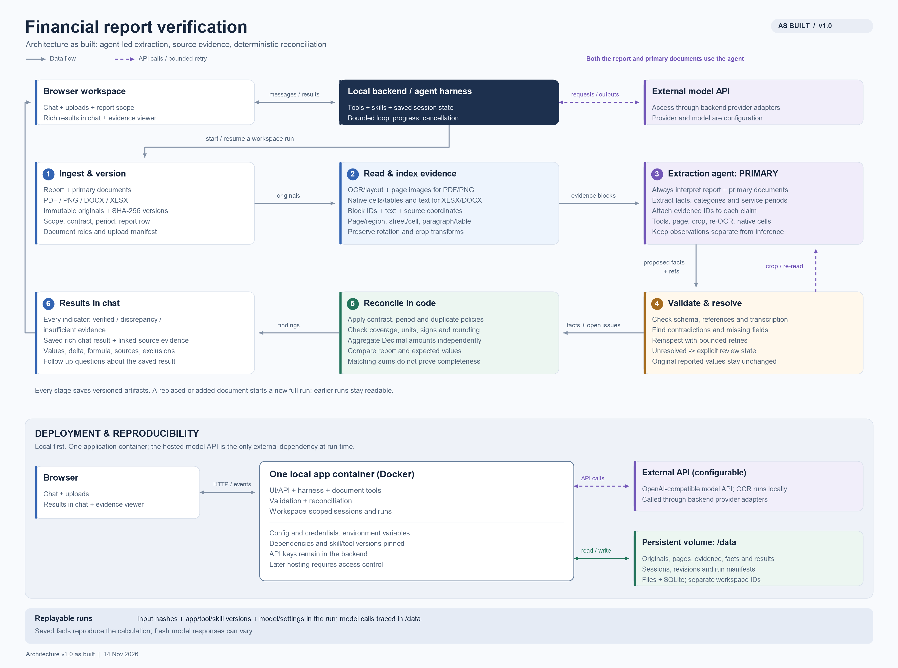

# Architecture

This describes the submitted build. The agent and OCR/layout are the main interpretation path. Results appear directly in chat with clickable evidence. Startup, settings and use cases: [README](../../README.md).

[Shareable PNG](architecture.png) · [Editable SVG](architecture.svg) · [Team tasks](../planning/README.md) · [Harness configuration and integration](../harness.md)

## Where it runs

- **Local browser:** chat, uploads, progress, result cards and evidence panel.
- **Local Docker application:** Python API, harness, document tools, validation, reconciliation and browser assets.
- **Local `/data` volume:** originals, page images, evidence, conversations, run results and SQLite metadata.
- **External API:** the configured OpenAI-compatible model. OCR runs locally with Tesseract; no hosted OCR is used. Calls originate from the backend; credentials stay there. Local execution does not mean offline processing.

This is a local/team installation. Workspace separation prevents accidental mixing; it is not public multiuser authentication.

### Browser handoff for T12

Serve `/app` as the chat entry point; `/` still opens the original batch form. The existing Docker `COPY sverka ./sverka` includes `static/` and its bundled fonts. No JavaScript build, separate frontend server or browser-side provider configuration is needed.

The chat uses the existing workspace API and T11's live service. It polls real stage counters and fetches saved outcome messages after completion/failure, including when the message is saved just after the final run snapshot. Files, runs and conversation messages live in `/data`; the saved-workspace list and layout preferences live in the browser. Keep that volume across restarts.

The evidence panel's new-tab link opens `/static/evidence.html` with the selected document version and fragment. It fetches the existing evidence API and keeps the highlight, excerpt and zoom controls; the original-file link remains separate. Old assistant messages are cleaned for display without changing their stored text. New follow-ups validate a private answer envelope before showing prose and typed cards.

Browser checks run with `python -m pytest -q tests/test_ui_browser.py tests/test_ui_static.py` after installing `requirements-browser.txt` and Chrome/Edge or Playwright Chromium. They exercise the complete service with a scripted model; the real-provider and clean-Docker checks remain release acceptance.

## Data flow

The **harness** is the Python loop around the model: send context, execute an allowed tool request, return the output and stop at completion or a limit. Skills are procedure instructions. Preparation and validation are ordinary Python functions; they do not each need an agent framework.

T08 uses pinned Qwen-Agent (`FnCallAgent`) for model/tool iteration, with our application retaining document scheduling, evidence checks, validation, budgets, progress, and persistence. DeepSeek Flash remains the configured model choice; framework and model are separate. The integration exposes our tools without enabling stock RAG, shell execution, or the framework's optional chat UI. See the [integration guide](../harness.md) for setup and API keys.

The retained OCR implementation uses local Tesseract with Russian/English language data. It was reused from the prototype for text and source coordinates; this is not a measured claim that it is the best or sufficient OCR for the corpus. Preserve page images and model inspection alongside OCR, and verify amounts and locations on real documents before closing extraction acceptance. Native XLSX/DOCX content keeps its own locators rather than going through OCR.

## Contracts

T01 implements these proposed contracts and example payloads. This is the shared reference for fields and policies.

| Object | Required content |
|---|---|
| `Scope` | Contract, report row, inclusive dates, `coverage_basis="supplied_bundle"`; confirmed before starting |
| `DocumentVersion` | Workspace/document/version IDs, SHA-256, role (`report`, `primary`, `context`), original filename, format, original-artifact ID |
| `EvidenceBlock` | Version ID, block ID, text, extraction method, typed locator; optional OCR quality metadata |
| `PreparedDocument` | Document reference, evidence blocks, page/image IDs, formula states, warnings/read errors |
| `ProposedField` | Model-proposed name/value, evidence IDs, observed/inferred distinction, unresolved reason; no acceptance flag |
| `FieldObservation` | Validator-produced value or null, evidence IDs, accepted/unresolved state, findings/reason |
| `ReportExtraction` | Header/indicator inventory with evidence, labels/units; one observation slot per entry, including unreadable fields |
| `PrimaryExtraction` | Number, contracts, issue date, service period, amount/currency/unit, category/allocation; observations, conflicts, possible categories |
| `IndicatorResult` | Reported value, partial `observed_sum`, complete `expected_value` or null, `diff` or null, coverage/status/category, contributions/evidence |
| `Conclusion` | Known component discrepancies, incomplete indicators, grand-total support/difference, summary; avoid double-counting dependent findings |
| `Run` | Workspace/run IDs, predecessor, input versions, scope, status/stage/progress, observations/results, replay manifest |
| `ChatMessage` | Role/text, run ID, typed result cards/evidence references; no parsing financial values from prose |

Money uses decimal strings in JSON and `Decimal` in calculations. Dates are ISO dates. Zero is a value; null is unresolved. The supplied report has 15 numeric indicators, columns 3–17; other layouts use their own inventory.

Evidence locators:

- **PDF/PNG:** 1-based page, stored displayed-render ID, pixel box, image dimensions and rotation/crop transform.
- **XLSX:** sheet/cell or range, original formula, cached value, separately derived value/evaluation state and input-cell lineage.
- **DOCX:** exact quote plus paragraph or table/cell address. Full page rendering is optional.

Amount, category and period may cite different blocks. Coordinates come from document tools, not model guesses. A block ID establishes location; validation still checks whether its content supports the claim. Only `validate_extraction` assigns accepted/unresolved states.

## Tool boundary

Evidence functions: `prepare_document`, `read_evidence`, `inspect_page`, `inspect_crop`, `reocr_region`, `read_cells`, `validate_extraction`.

Application functions: version/artifact storage, `reconcile(scope, report, primaries, manifest)`, `get_result`, chat/run persistence. Optional `record_correction` creates a new run.

Implemented in `sverka/document_tools.py` (`DocumentTools(store, validator=...)`): preparation in `sverka/preparation.py` and `sverka/formulas.py` (T04); inspection tools `read_evidence`, `inspect_page`, `inspect_crop`, `reocr_region`, `read_cells` (T05). `validate_extraction` delegates to the T06 validator passed in: `sverka/extraction.py` (`ExtractionValidator`, one per run). It accepts a field only when the cited evidence of the same document shows the value, keeps contradictions unresolved and saves the report inventory; its rules for the model are in `sverka/skills/extraction.md`.

Tools take workspace-scoped IDs and typed arguments. Return `ok`, `data`, `warnings` and a typed error where applicable: `unreadable`, `unsupported`, `not_found`, `invalid_reference`, `timeout`. Errors never become empty successful extractions.

## HTTP routes

| Route | Purpose |
|---|---|
| `POST /api/workspaces` | Create workspace |
| `POST /api/workspaces/{wid}/documents` | Upload with role; return versions |
| `GET /api/workspaces/{wid}/documents` | List versions, e.g. after a refresh |
| `POST /api/workspaces/{wid}/runs` | Start versions/scope; return run ID immediately |
| `GET /api/workspaces/{wid}/runs` | List runs, e.g. after a refresh |
| `GET /api/workspaces/{wid}/runs/{rid}` | Read progress and saved result |
| `POST /api/workspaces/{wid}/runs/{rid}/cancel` | Cancel safely |
| `POST/GET /api/workspaces/{wid}/messages` | Submit/restore conversation and result cards |
| `GET /api/workspaces/{wid}/evidence/{eid}` | Get text/locator and artifact URL |
| `GET /api/workspaces/{wid}/artifacts/{aid}` | Serve version-scoped original/page/crop |
| `GET /health` | Readiness/configuration state without credentials |

Use polling. Run statuses: `queued`, `running`, `completed`, `failed`, `cancelled`, `interrupted`; stage is separate. Completed checks may contain unverified indicators. Allow one active check per workspace. Unfinished work becomes `interrupted` after restart; explicit retry creates a new run.

Implemented in `sverka/api.py` (T02). Bodies are the v1 contract models; errors are `{"error": ToolError}` with status 400/404/409/413/415/422. Uploads take one `role` per request; a `.zip` is unpacked into separate versions; `document_id` adds a replacement version. `SVERKA_RUN_MODE=live` (default) starts the complete check in the background through `sverka/run_service.py` (T11): preparation, harness, validation, reconciliation, then one atomic save of the completed run and a chat message with the conclusion. Without a configured provider the check fails at once with `missing_credentials`. `SVERKA_RUN_MODE=disabled` fails a started check with a clear message; `SVERKA_RUN_MODE=fixture` completes it with the labelled synthetic example for interface work only.

## Reconciliation policies

1. Preserve reported observations. Arithmetic inconsistencies become findings, never rewritten source values.
2. Prefer explicit service period. Otherwise apply/record the agreed issue-date rule. Partial overlap stays unresolved; no invented proration.
3. Exact duplicate bytes count once. Number/date/amount is a candidate: check contract and available identifiers. Conflicting versions stay unresolved.
4. Confirm aggregation only from accepted amount, category/allocation and eligibility. Model confidence or matching totals cannot replace acceptance.
5. Require distinct monthly coverage for payroll/contributions, even with one surviving statement. Do not count totals and details twice.
6. Verification covers the supplied bundle, not all real-world records. Nonmonthly coverage is complete in scope only when no missing reference, unreadable input, conflicting version or unresolved allocation could affect it.
7. Verify zero only in a closed scope with no accepted or unresolved possible expense. Unknown relevance blocks every plausible category.
8. Keep partial `observed_sum` separate. Incomplete coverage makes complete `expected_value`/`diff` null, including the total. Retain independent component discrepancies in the conclusion.
9. Normalize currency, units and signs; use half-up rounding and configurable RUB 0.01 tolerance initially. Unsupported allocations stay unresolved.

## Limits and replay

Start with at most two reinspection rounds per document, finite per-document tool/request budgets and a run-wide budget allowing all 23 initial documents. Keep unresolved fields after exhaustion. Failures/cancellation preserve artifacts without false completion.

Record input hashes, app/tool/skill versions, provider/model configuration and actual outputs, excluding secrets. Replaying accepted facts reproduces calculations; fresh model responses can differ. Corrections or added documents create new full runs. Incremental recalculation and a correction editor are optional.

## Two use cases

1. **Complete bundle:** stage 3/2026, contract `24/03/15-01`, January–May. Production overhead is overstated by RUB 12,500. Show four source contributions, three exclusions and unsupported details.
2. **March payroll missing:** identify incomplete payroll/total support while retaining the overhead discrepancy. Adding the statement creates a new run.

Exact values/tests: [validation](../planning/05-validation.md). Both cases were run through the chat with the real model; see the [release check](../release-check.md#t13-both-use-cases-through-the-chat-14-nov-2026).
