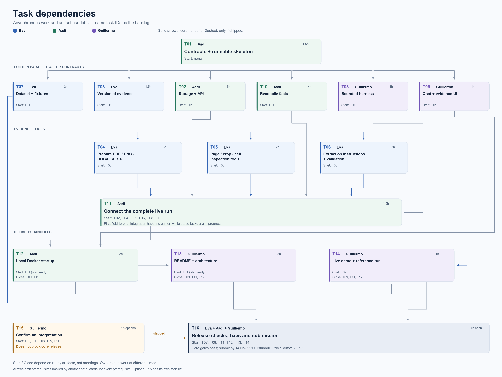

# Dependencies and handoffs

Task definitions/owners: [backlog](03-backlog.md). Dates: [team plan](README.md#checkpoints). Cards list exact start/closing prerequisites; arrows omit links already implied by another path. T15 is optional.

[Shareable PNG](assets/dependencies.png) · [Editable SVG](assets/dependencies.svg)

## Early handoffs

| Producer → consumer | Deliverable |
|---|---|
| Aadi → both | Schemas and five example payloads in T01; minimal save/read interface early in T02 |
| Eva → both | Correct dataset manifest/synthetic expected results early in T07 |
| Eva → Guillermo | One prepared PDF/XLSX, inspection functions and validator with example outputs |
| Guillermo → both | Fake-provider loop first, then real provider/tool request and progress callbacks |
| Aadi → Guillermo | Fixture reconciliation result before real extraction |
| Guillermo → Aadi | Static assets and chat/run handlers for route registration |

Each handoff includes a callable boundary, example and check. T06 does not import T08; T08 uses fake validation until Eva's function is ready. T09 starts with result fixtures; T10 starts without OCR. This avoids a circular wait.

## Asynchronous coordination

No task requires three-way attendance. Each owner publishes a handoff with the commit, callable interface, example payload, test/reproduction command and known limitations.

| Coordination point | Owner and asynchronous review |
|---|---|
| T01 contracts | Aadi publishes v1 from the written architecture; Eva/Guillermo review when available. Breaking changes require affected consumers' explicit review, not silence as approval |
| T11 integration | Aadi runs committed components and records failures for their owners with reproductions |
| T14 demonstration | Guillermo records the flow; Eva checks evidence/numbers and Aadi checks startup separately |
| T16 release | Each person records assigned checks against the release commit; Guillermo collects results/submits |

Before T01 is ready, Eva can inventory/repair the dataset and inspect readers; Guillermo can verify provider access and sketch the static UI. Contract-dependent implementation still waits for the published v1 examples. Aadi should publish small interfaces before going offline; if that cannot happen, explicitly transfer ownership rather than creating competing contracts.

## Critical path and ownership

Contracts → real evidence → agent → validation → reconciliation → chat/evidence → clean launch. Eva's evidence tasks and Guillermo's harness/UI tasks share owners even when code dependencies permit parallel development.

Test the first real slice as soon as compatible evidence, validation, harness and storage handoffs are ready. T11 closes the full dataset connection; it must not be the first integration attempt. Different schedules add waiting time to the critical path even when engineering-hour estimates stay unchanged.

Aadi owns schemas, storage, route declarations, run service, reconciliation and Docker. Eva owns preparation/evidence, extraction validation/instructions and fixtures. Guillermo owns harness/provider, static UI, assistant instructions, README/defense. Coordinate shared-file changes rather than having all three edit `web.py` or contracts independently.

If Eva's work expands, Aadi can take fixture/formula-test maintenance after storage. If UI expands, Aadi can help with artifact routes. Keep the model loop with Guillermo and final financial policy with Aadi. An early finisher works on a failed gate rather than adding features.
