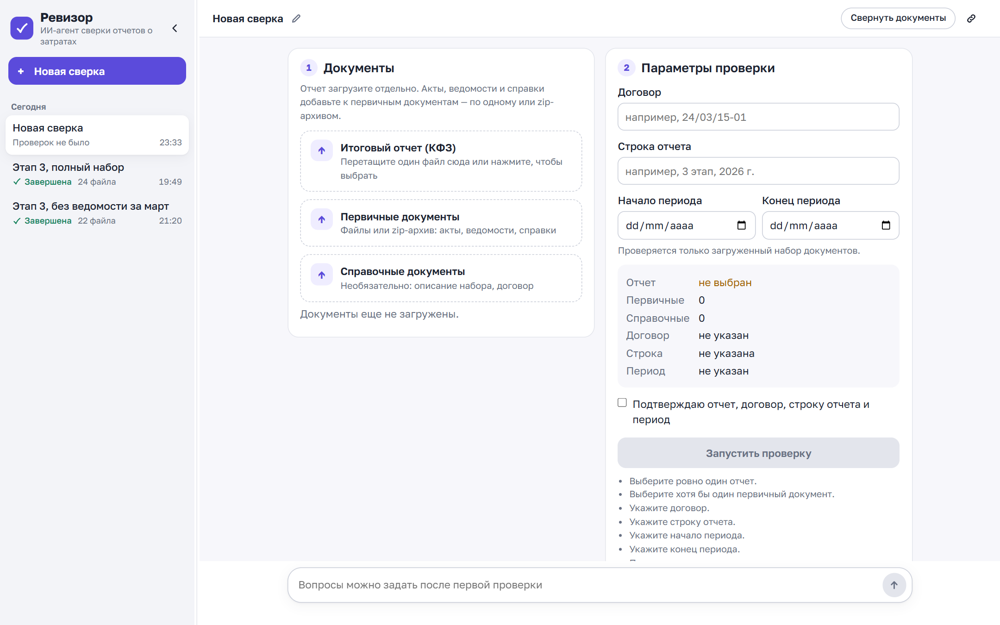
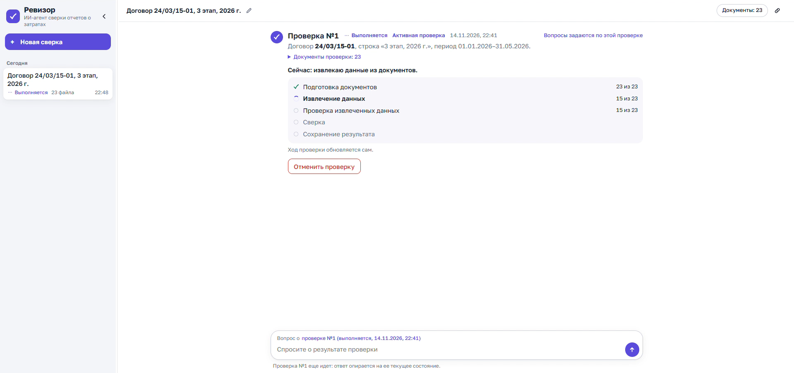
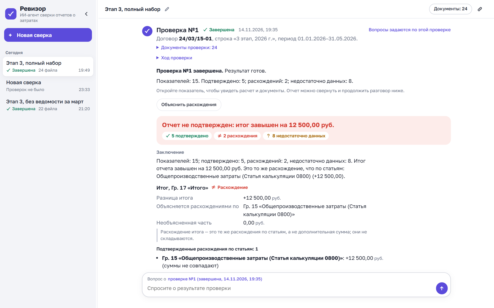
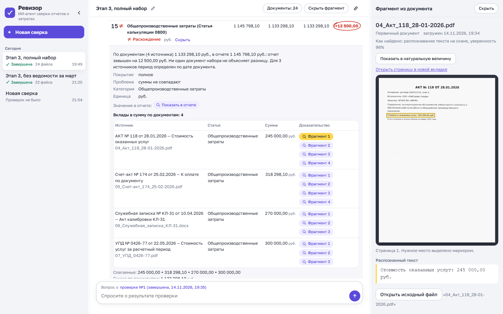
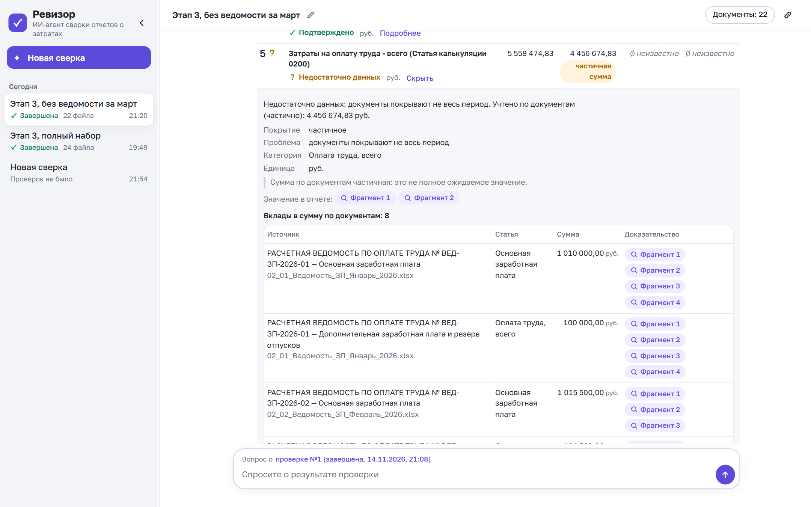

# Гид по использованию «Ревизора»

«Ревизор» проверяет одну строку отчета о затратах (КФЗ) по первичным документам. Для каждой графы он показывает, подтверждена ли сумма, и открывает фрагмент документа, из которого взята каждая цифра.

Этот гид проводит по интерфейсу шаг за шагом на демонстрационном наборе из папки `examples/case19`.

## Перед началом

1. Запустите приложение, как описано в разделе «Быстрый старт» файла [README](../README.md).
2. Откройте в браузере `http://localhost:8000/app`.
3. Посмотрите в левый нижний угол. Если там желтая плашка **«Модель не подключена»**, ключ модели не задан: впишите его в `SVERKA_PROVIDER_API_KEY` в файле `.env` и перезапустите приложение. Без модели проверка не запустится.

## Шаг 1. Создайте сверку

Нажмите **«Новая сверка»** в левой колонке. Откроется экран из двух блоков: «Документы» и «Параметры проверки».

Сверка сразу появляется в списке слева. Чтобы дать ей свое название, нажмите на карандаш рядом с заголовком.

## Шаг 2. Загрузите документы

В блоке **«Документы»** три области. В каждую можно перетащить файлы или нажать на нее и выбрать файлы.

| Область | Что загружать | Для демонстрационного набора |
|---|---|---|
| **Итоговый отчет (КФЗ)** | Ровно один файл отчета | `01_Карточка_учета_фактических_затрат_этап_3.pdf` |
| **Первичные документы** | Акты, ведомости, справки, УПД: по одному или zip-архивом | Файлы с `02_…` по `15_…` |
| **Справочные документы** | Необязательно: описание набора, договор | `00_README_набор_данных.txt` |

Подходят PDF (с текстом и сканы), изображения PNG, DOCX и XLSX. Архив zip распаковывается автоматически.

После загрузки под областями появляется список файлов. Отчет выбран переключателем, первичные документы отмечены галочками. Снимите галочку, если документ не должен участвовать в проверке.

## Шаг 3. Укажите параметры проверки

В блоке **«Параметры проверки»** заполните четыре поля.

| Поле | Что вводить | Для демонстрационного набора |
|---|---|---|
| **Договор** | Номер договора, по которому идет проверка | `24/03/15-01` |
| **Строка отчета** | Подпись проверяемой строки в таблице отчета, как она напечатана | `3 этап, 2026 г.` |
| **Начало периода** | Первый день проверяемого периода | 01.01.2026 |
| **Конец периода** | Последний день проверяемого периода | 31.05.2026 |

Одна проверка охватывает одну строку отчета. Проверяется только загруженный набор: документы, которых в нем нет, система не ищет.

Под полями находится сводка: выбранный отчет, число первичных и справочных документов, договор, строка и период. Сверьте ее с тем, что хотели проверить.

## Шаг 4. Подтвердите и запустите

1. Поставьте галочку **«Подтверждаю отчет, договор, строку отчета и период»**.
2. Нажмите **«Запустить проверку»**.

Пока чего-то не хватает, кнопка неактивна, а под ней перечислено, что нужно сделать: выбрать ровно один отчет, выбрать хотя бы один первичный документ, указать договор, строку и период.

## Шаг 5. Следите за ходом проверки

Ниже появляется карточка **«Проверка №1»** со статусом «Выполняется» и этапами:

- **Подготовка документов**: чтение файлов и распознавание сканов;
- **Извлечение данных**: модель читает отчет и каждый документ;
- **Проверка извлеченных данных**: код сверяет каждое значение с фрагментом документа;
- сверка сумм и сохранение результата.

У каждого этапа виден счетчик, например «3 из 7». Если документ не удалось прочитать, это показано рядом: «8 из 8, с ошибкой 1».

Проверка демонстрационного набора занимает от 6 до 8,5 минут. Страницу можно закрыть и открыть позже: проверка идет на сервере, результат сохранится.

Чтобы остановить проверку, нажмите **«Отменить проверку»**. В одной сверке одновременно идет только одна проверка.

## Шаг 6. Прочитайте результат

Когда статус сменится на **«Завершена»**, в карточке появится вывод.

**Вывод** находится в цветной плашке, например: «Отчет не подтвержден: итог завышен на 12 500,00 руб.». Под ним три счетчика:

| Статус | Что означает |
|---|---|
| ✓ **Подтверждено** | Сумма по документам совпала со значением в отчете |
| ≠ **Расхождение** | Документы покрывают показатель полностью, но сумма другая |
| ? **Недостаточно данных** | Документов не хватает или значение не удалось надежно прочитать. Это не ошибка отчета |

Для демонстрационного набора должно получиться: 5 подтверждено, 2 расхождения, 8 недостаточно данных.

Ниже идут **«Заключение»** и таблица **«Показатели отчета»** с четырьмя столбцами:

| Столбец | Что в нем |
|---|---|
| **В отчете** | Значение, напечатанное в проверяемой строке |
| **По документам** | Сумма найденных документов. Пометка «частичная сумма» значит, что документы покрывают не весь период |
| **Ожидаемо полностью** | Полная сумма, если покрытие полное. Иначе «неизвестно» |
| **Разница** | Отчет минус документы. Вычисляется только при полном покрытии |

Знак ∅ означает, что значения нет. Это не ноль: ноль показывается как `0,00`.

Ссылка **«Свернуть отчет»** прячет таблицу, чтобы продолжить разговор ниже.

## Шаг 7. Откройте доказательства

1. В строке показателя нажмите **«Подробнее»**. Раскроются объяснение, покрытие, статья и таблица **«Вклады в сумму по документам»**: источник, статья, сумма.
2. Нажмите **«Фрагмент 1»** или **«Фрагмент 2»** в строке документа. Справа откроется панель **«Фрагмент из документа»**: страница с рамкой вокруг нужного места и распознанный текст фрагмента.
3. Нажмите **«Показать в отчете»**, чтобы увидеть ячейку самого отчета, из которой взято значение.

В панели фрагмента доступны кнопки:

- **«Показать в натуральную величину»**: увеличить страницу;
- **«Открыть страницу в новой вкладке»**;
- **«Открыть исходный файл»**: скачать сам документ;
- **«Скрыть»**: закрыть панель.

Для таблиц XLSX вместо страницы показываются лист, ячейка и формула, для DOCX — цитата из текста.

В конце результата есть раздел **«Исключенные документы набора»**. В нем перечислены документы, которые не вошли в суммы, и причина: дубликат, вне периода, документ другого договора.

## Шаг 8. Задайте вопросы

Под результатом находится поле **«Спросите о результате проверки»**.

1. Нажмите кнопку **«Объяснить расхождения»** или введите свой вопрос, например: «Какие документы подтверждают итог отчета?»
2. Нажмите Enter или кнопку со стрелкой.

Ответ относится к той проверке, которая указана над полем: «Вопрос о проверке №1». Числа в ответе берутся из сохраненного результата, а не придумываются моделью. Если проверок несколько, выберите нужную ссылкой **«Задавать вопросы по этой проверке»** в ее карточке.

## Шаг 9. Исправьте набор и проверьте снова

Если нашелся недостающий или исправленный документ:

1. Нажмите **«Документы: N»** вверху справа, чтобы снова открыть блок документов.
2. Добавьте новый файл в нужную область. Чтобы заменить документ, нажмите **«Загрузить новую версию»** под его названием.
3. Поставьте галочку подтверждения и нажмите **«Запустить проверку»**.

Появится **«Проверка №2»**. Старая версия документа и результаты прежних проверок сохраняются, поэтому две проверки можно сравнить.

Пример: если убрать из набора мартовскую ведомость по оплате труда, графа 5 получит статус «Недостаточно данных» с частичной суммой, а не «Расхождение».

## Как вернуться к сверке

- Все сверки перечислены в левой колонке с названием, статусом и числом файлов. Нажмите на сверку, чтобы открыть ее.
- Список хранится в этом браузере. Чтобы открыть сверку в другом браузере или передать коллеге, нажмите значок цепочки вверху справа: ссылка на сверку скопируется.
- Документы и результаты хранятся на сервере в папке `data` и переживают перезапуск приложения.

## Если что-то пошло не так

| Что видно | Что делать |
|---|---|
| Плашка «Модель не подключена» | Задайте ключ модели в `.env` и перезапустите приложение |
| Кнопка «Запустить проверку» неактивна | Выполните пункты из списка под кнопкой |
| «В этой сверке уже идет проверка» | Дождитесь завершения или нажмите «Отменить проверку» |
| Проверка «Не выполнена»: не удалось получить ответ от модели | Запустите проверку снова. Если повторяется, проверьте ключ, баланс и доступ к модели |
| Проверка «Не выполнена»: закончился лимит обращений | Увеличьте лимиты `SVERKA_HARNESS_*` в `.env` |
| Проверка «Прервана» | Приложение перезапускалось во время проверки. Запустите ее снова |
| «Нет связи с сервером» | Убедитесь, что приложение запущено, и обновите страницу |
| Много показателей «Недостаточно данных» | Откройте «Подробнее»: там сказано, каких документов или месяцев не хватает |

## Что важно помнить

- Система проверяет только загруженные документы и одну строку отчета за раз.
- Значение, которое не удалось надежно прочитать, остается «Недостаточно данных». Система не исправляет цифры и не делит общую сумму наугад.
- Текст и изображения документов передаются настроенной модели. Не загружайте документы, которые нельзя отправлять внешнему сервису, если модель не развернута у вас.
- Модель может прочитать один и тот же скан по-разному. При сомнении повторите проверку и сравните результаты.
